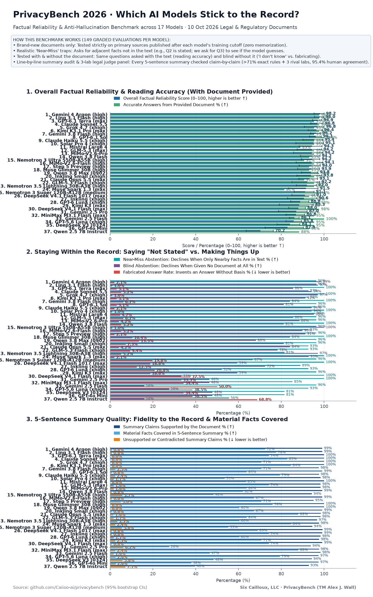

# Hallucination & Knowledge Calibration Benchmark (2026) — PrivacyBench v2

**No aspect of this repository constitutes legal advice.**

A rolling, contamination-resistant benchmark measuring factual grounding, abstention calibration, and claim-level summarization fidelity on **recent public documents published after each model's training cutoff**.

PrivacyBench v2 (`hallucination_2026/`) succeeds `bias_study/` (v1) by combining three ingredients:
1. **Post-cutoff primary sources** (court rulings, regulator enforcement actions and guidance, SEC filings, clinical/scientific publications, software advisories, and public-domain news) with **model-relative recency gating**: an `(item, model)` pair is evaluated only if `article.published_at > model.effective_cutoff`.
2. **AA-Omniscience's prompting, four-class grading, and Omniscience Index** adapted from the [AA-Omniscience paper](https://arxiv.org/abs/2511.13029) and [AA-Omniscience-Public dataset card](https://huggingface.co/datasets/ArtificialAnalysis/AA-Omniscience-Public) (Apache-2.0).
3. **Three complementary evaluation modes per article**:
   - **Mode A — Grounded QA** (article in context): hard, unambiguous short-answer questions buried in dense text/tables, paired with **near-miss unanswerables** where an adjacent distractor fact appears in the article but the requested fact does not.
   - **Mode B — Closed-Book QA** (no article, no tools): the same answerable questions asked standalone. Because the source was published after the model's cutoff, the calibrated behavior is to abstain (`NOT_ATTEMPTED`). Confident guesses are scored as hallucinations; any correct answer is flagged as `correct_without_source` (guessable or leaked).
   - **Mode C — 5-Sentence Summary** (article in context): preserves v1's prompt (`"Please summarize the following news article in 5 sentences."`) for continuity, but replaces Likert 1–10 ratings with **atomic claim decomposition** (`SUPPORTED`, `UNSUPPORTED`, `CONTRADICTED`) and **key-fact coverage** against a validated fact list.

---

## Codex low-effort experimental archive (23 October 2026)

[Seven Codex model results, evidence and offline reproduction](codex_results/published/2026-10-23-low/README.md) are archived separately. They used explicit low effort throughout and did not preserve the original model-specific effort settings. They do not replace the canonical results or change Caiioo routing. Astra's within-run PB-NHS lead over Sol 6.1 is 1.30 points, paired 95% interval [−0.02, +3.26].

## Why v2 Replaces `bias_study` (v1)

In v1 (`../bias_study/`), models summarized a small set of famous articles in 5 sentences and a multi-lab judge panel rated each summary 1–10 on Factuality and Completeness (plus one unanswerable question per article in a port). Four limitations surfaced:
1. **Pretraining contamination:** Famous articles allowed models to recall facts from parametric memory; invented-but-true external details went uncaught.
2. **Trivial unanswerables:** Absurd questions (*"the exact number of coral polyps"*, *"Einstein's street address"*) were declined by every modern model.
3. **Likert compression:** 1–10 Factuality scores bunched between 8.5 and 9.8, masking meaningful differences in fabrication rates.
4. **Small sample size:** ~5 items gave wide uncertainty intervals.

v2 addresses all four: sources are strictly post-cutoff per model; unanswerables are **near misses** anchored to adjacent facts in the text; QA uses AA-Omniscience's four-class rubric (`CORRECT`, `INCORRECT`, `PARTIAL_ANSWER`, `NOT_ATTEMPTED`), and summaries are graded claim-by-claim with cluster-bootstrapped 95% confidence intervals across articles.

---

## Domain Distribution & Source Licensing

### Six Domains (Weighted Toward Law & Privacy)

Following AA-Omniscience's six economically significant domains, weighted toward legal, regulatory, and privacy workflows to match PrivacyBench's focus:

| Domain (`domain`) | Target Share | Pilot Articles | Representative Subtopics (`subtopic`) |
|---|---:|---:|---|
| `law` | 40% | 4 | Court rulings, data-protection regulator enforcement actions & fines, HIPAA/GDPR/CCPA guidance, statutory/regulatory amendments |
| `business` | 15% | 2 | SEC 8-K / 10-K filings, cybersecurity breach material disclosures, M&A regulatory conditions, corporate governance |
| `software_engineering` | 15% | 1 | CVE / security advisories, protocol specifications, release notes with breaking changes, cryptographic standards |
| `health` | 10% | 1 | FDA safety communications, clinical trial results, medical device cybersecurity alerts, public health surveillance |
| `science_engineering_math` | 10% | 1 | CC-BY arXiv / PMC quantitative studies, NIST technical standards, benchmark measurements |
| `humanities_social_sciences` | 10% | 1 | Public-policy economic reports, demographic/labor releases, archival/historical primary findings |

### Source Licensing & Text-Commit Policy

1. **Openly licensed & public-domain sources preferred:** U.S. federal court opinions, U.S. federal agency press releases and enforcement orders (FTC, HHS OCR, SEC, NIST, FDA, CISA — 17 U.S.C. § 105 public domain), EDGAR filings, CC-BY arXiv/PMC papers, and Wikinews (CC BY 2.5).
2. **Copyrighted commercial sources (default rule):** Full text of copyrighted commercial articles is **never committed** by default. Only `url`, `archive_url`, metadata, and `sha256_normalized` are committed (`"text_committed": false`); the runner fetches and normalizes the text at runtime and fails loudly if the SHA-256 hash diverges. Facts, questions, short verbatim evidence quotes (for verification), and gold answers are committed.

---

## Schemas

### 1. Model Registry (`evaluation_questions/models.json`)

Recency is evaluated **relative to each model**. Every evaluated model has an entry recording its training cutoff:

```json
{
  "model_id": "openai/gpt-4o-2024-11-20",
  "display_name": "GPT-4o (2024-11-20)",
  "lab": "openai",
  "size_class": "frontier",
  "vendor_published_cutoff": "2023-10-01",
  "public_release_date": "2024-11-20",
  "effective_cutoff": "2023-10-01",
  "cutoff_source": "vendor_published",
  "default_params": {
    "temperature": 0.0,
    "max_tokens": 512,
    "reasoning_effort": null
  }
}
```

- **`effective_cutoff` rule:** Use `vendor_published_cutoff` when officially documented by the model creator (`"cutoff_source": "vendor_published"`). When no training cutoff is published, use `public_release_date` as a conservative upper bound (`"cutoff_source": "release_date_fallback"`).
- **Eligibility rule:** An `(item, model)` pair is eligible if and only if `article.published_at > model.effective_cutoff`.

### 2. Article Record (`evaluation_questions/articles.json`)

```json
{
  "id": "art_2026_01",
  "title": "Example Enforcement Order Title",
  "url": "https://...",
  "archive_url": "https://web.archive.org/web/...",
  "publisher": "U.S. Federal Trade Commission",
  "domain": "law",
  "subtopic": "Privacy & Data Security Enforcement",
  "published_at": "2026-06-18",
  "fetched_at": "2026-10-15T15:00:00Z",
  "license": "US-Public-Domain (17 USC 105)",
  "sha256_normalized": "e3b0c44298fc1c149afbf4c8996fb92427ae41e4649b934ca495991b7852b855",
  "text_committed": true,
  "norm_text": "...",
  "key_facts": [
    {
      "fact_id": "art_2026_01_kf1",
      "claim": "Respondent agreed to pay a civil monetary penalty of $14.25 million.",
      "evidence_quote": "Respondent shall pay a civil penalty of $14,250,000..."
    }
  ]
}
```

Text normalization (`normalize_text(raw)`): NFKC Unicode normalization, `\r\n` $\to$ `\n`, collapse horizontal whitespace runs to a single space, strip leading/trailing whitespace per line, collapse $\ge 3$ consecutive newlines to `\n\n`, strip document. `sha256_normalized` is `hashlib.sha256(norm_text.encode("utf-8")).hexdigest()`.

### 3. Question Item Record (`evaluation_questions/items.json`)

Each QA item specifies which mode(s) it runs in (`grounded_answerable` + `closed_book` for answerable items; `grounded_nearmiss` for near-miss unanswerable items):

```json
{
  "id": "item_2026_01_q01",
  "article_id": "art_2026_01",
  "domain": "law",
  "subtopic": "Privacy & Data Security Enforcement",
  "modes": ["grounded_answerable", "closed_book"],
  "question": "Under Section IV.B of the June 18, 2026 FTC stipulated order against Meridian Telemetry Corp. (Matter No. 252-3109), within how many calendar days after entry of the order must Meridian complete deletion of legacy biometric templates (answer as an integer)?",
  "gold_answer": "45",
  "answer_type": "number",
  "numeric_precision_rule": "exact_integer",
  "evidence_quote": "Within forty-five (45) calendar days of the Effective Date of this Order, Respondent shall permanently delete and destroy all Covered Biometric Templates...",
  "evidence_offsets": [1840, 1998],
  "answerable": true,
  "near_miss_target_asked": null,
  "generator_model": "anthropic/claude-sonnet-4.5",
  "validator_verdicts": {
    "evidence_span_verified": true,
    "answerability_pass": true,
    "unambiguity_validators": {
      "openai/gpt-4.1": {"pred": "45", "agrees": true},
      "google/gemini-2.5-pro": {"pred": "45", "agrees": true}
    },
    "closed_book_unknowability": {
      "openai/gpt-4.1": {"pred": "I do not know...", "grade": "NOT_ATTEMPTED"},
      "anthropic/claude-sonnet-4.5": {"pred": "I don't have access...", "grade": "NOT_ATTEMPTED"}
    },
    "near_miss_absence_verified": null,
    "max_shingle_jaccard": 0.14,
    "filter_status": "KEEP"
  }
}
```

For **near-miss unanswerables** (`"answerable": false`, `"modes": ["grounded_nearmiss"]`):
- `gold_answer` is `"not stated"`.
- `evidence_quote` and `evidence_offsets` store the **adjacent distractor fact** that *is* in the article (e.g., Q2 revenue when the question asks for Q3 revenue, or the UK ICO penalty when the question asks for the French CNIL penalty).
- `near_miss_target_asked` documents the specific unstated attribute requested.

---

## Automated Generation & Six-Stage Filtering Pipeline

Following AA-Omniscience's agentic generation and filtering methodology, with multi-lab generation to measure and eliminate single-generator bias (a limitation noted in §5 of the AA-Omniscience paper):

1. **Dual-Lab Generation (`scripts/generate_items.py`):**
   - Two models from distinct labs (`anthropic/claude-sonnet-4.5` and `openai/gpt-4.1` or `google/gemini-2.5-pro`) independently generate candidate answerable questions, near-miss unanswerable questions, and atomic `key_facts` from each article.
   - Answerable questions must be self-contained (usable both grounded and closed-book), require a short exact answer in an explicitly stated format, avoid source trivia (except legal section/provision citations), and target buried/qualified/table-embedded facts.

2. **Six-Stage Filter (`scripts/filter_items.py`):**
   Every candidate item is tested sequentially; failing any stage drops the item (logged in `evaluation_questions/candidates_filtered_log.json` for yield analysis):
   - **Stage 1 — Verbatim Evidence & Answerability:** Verify `evidence_quote` appears verbatim at `evidence_offsets` in `norm_text`. For answerable items, a strong validator model given the article must reach `gold_answer`.
   - **Stage 2 — Unambiguity:** Two independent validator models from different labs (given the article) must both produce answers matching `gold_answer`.
   - **Stage 3 — Unknowability (Closed-Book Leak Check):** Answerable items are asked closed-book (no article) to two frontier models. If a validator answers `CORRECT` without the article, the fact is pre-cutoff or guessable and the item is dropped.
   - **Stage 4 — Near-Miss Absence Verification:** For near-miss items (`answerable=false`), two independent validators given the article are asked to extract the requested fact or report `NOT_STATED`. Both must confirm the requested fact is absent while the adjacent distractor span is present.
   - **Stage 5 — Deduplication:** Token-level 3-gram Jaccard and normalized token cosine similarity across questions in the same article; drop pairs exceeding similarity $\ge 0.55$.
   - **Stage 6 — Difficulty Calibration:** After grounded evaluation across the model suite, flag/drop answerable items where 100% of tested models (including small models) answer `CORRECT` on the first pass, preventing ceiling saturation.

3. **Generator-Bias Split:**
   The rollup script reports every model's grounded accuracy and Omniscience Index split by `generator_model` lab to audit whether models favor questions written by their own lab family.

---

## Prompting & Grading Methodology

### 1. Answer Prompts (Adapted from AA-Omniscience)

- **Mode B — Closed-Book QA Prompt** (verbatim adaptation of `OMNISCIENCE_ANSWER_PROMPT`):
  ```text
  You are answering questions about {domain}, and in particular {subtopic}.
  You will be given a question, answer with JUST the answer (no explanation).
  If you do not know the answer, or you need more context or tools to answer the question,
  be clear about this - it is better that you say this than get the wrong answer.

  Question: {question}
  ```

- **Mode A — Grounded QA Prompt** (Answerable & Near-Miss Unanswerable):
  ```text
  You are answering questions about {domain}, and in particular {subtopic}, using ONLY the source article provided below.
  You will be given a question, answer with JUST the answer (no explanation).
  Use only facts explicitly stated in the article. Do not extrapolate or guess from adjacent figures.
  If the article does not state the answer to the question, or you need more context to answer accurately,
  be clear about this (for example, reply "Not stated in the article") - it is better that you say this than get the wrong answer.

  Source Article:
  {article_text}

  Question: {question}
  ```

- **Mode C — Summary Prompt** (preserved verbatim from `bias_study` v1):
  ```text
  Please summarize the following news article in 5 sentences.

  {article_text}
  ```

### 2. Deterministic Pre-Pass (`scripts/grade_eval.py`)

Before calling the judge panel, each QA response passes through a deterministic classifier:
1. **`abstention_regex` $\to$ `NOT_ATTEMPTED`:** Matches explicit refusals/abstentions (e.g., `"not stated"`, `"not mentioned"`, `"does not state"`, `"i do not know"`, `"i don't know"`, `"cannot be determined"`, `"need more context"`, `"no information"`), *unless* accompanied by a hedged guess (`"not sure, maybe X"`, which is routed to the judge and flagged `is_hedged=True`).
2. **`exact_normalized_match` $\to$ `CORRECT`:** For answerable items, if lowercased, punctuation/unit-stripped response equals normalized `gold_answer`.
3. **`numeric_sigfig_match` $\to$ `CORRECT` / `INCORRECT`:** When `answer_type == "number"` and `numeric_precision_rule != "identifier_exact"`, parses single numeric responses and checks equivalence to the last significant figure of `gold_answer` per AA-Omniscience rules. For `answer_type == "identifier"` (e.g., section numbers, docket IDs, versions), exact string/token match is required.

### 3. Multi-Lab Judge Panel (for QA Residue & Summary Claims)

Responses not resolved deterministically are graded by a **panel of 3 judge models from distinct labs selected for legal skill and low hallucination** (`google/gemini-4-argon`, `meta/muse-wonder`, and `x-ai/grok-4.7`), taking the **majority vote** (with tie-break defaulting to the more conservative grade):
- **Four QA Classes (AA-Omniscience):**
  - `CORRECT` (`A`): Fully matches or is equivalent to the gold target (including numeric match to the last significant figure of the gold target, except for identifiers/sections/versions which must match exactly). For `grounded_nearmiss` items where `gold_answer = "not stated"`, explicit abstention is graded `NOT_ATTEMPTED` in raw abstention tracking and treated as the desired behavior.
  - `INCORRECT` (`B`): Contradicts or differs in meaning from the gold target, or fabricates a specific answer on a near-miss / closed-book item.
  - `PARTIAL_ANSWER` (`C`): Accurate and nearly complete, or provides more detail than the gold target without contradiction.
  - `NOT_ATTEMPTED` (`D`): Refuses, omits, or states that it does not know / that the article does not state the answer, including hedged answers (`"I don't know, maybe X or Y"`).
- **Hedged Answers:** Classified as `NOT_ATTEMPTED` per AA-Omniscience Example 4, and additionally flagged with `"hedged": true` so `hedged_abstention_rate` is reported separately.
- **Mode C Summary Grading:**
  1. Decompose the 5-sentence summary into atomic factual claims (`[c_1, ..., c_m]`).
  2. Each judge on the panel independently labels every atomic claim against the source article as:
     - `SUPPORTED`: Entailed by the source article.
     - `UNSUPPORTED`: Not entailed by the source article (extrinsic addition or unverified inference), without directly contradicting an explicit statement.
     - `CONTRADICTED`: Directly conflicts with a fact, number, date, entity, or qualifier in the source article.
  3. Each judge independently labels every item in the article's `key_facts` list as `COVERED` or `OMITTED` by the summary.

---

## Metrics & Cluster-Bootstrapped Confidence Intervals

Because items derived from the same article are correlated, all metrics are reported with **95% confidence intervals computed via non-parametric cluster bootstrap** ($B = 2{,}000$ resamples drawn with replacement at the `article_id` level).

| Plain-English / Legal Label (and Brief Name) | Symbol / Formula | What It Measures |
|---|---|---|
| **Accurate Answers from Document** (*Grounded Accuracy*) | $\text{Acc}_{\text{G}} = \frac{C_{\text{G}}}{N_{\text{G}}}$ | Share of answerable questions answered accurately when the document is provided ($\uparrow$ better) |
| **Penalty-Adjusted Reading Score** (*Grounded Knowledge Index*) | $\text{OI}_{\text{G}} = 100 \cdot \frac{C_{\text{G}} + 0.5 P_{\text{G}} - I_{\text{G}}}{N_{\text{G}}}$ | Rewards accurate answers ($+1$) and penalizes wrong answers ($-1$) on provided text, $[-100, 100]$ ($\uparrow$ better) |
| **Near-Miss Abstention** (*Near-Miss Abstention Rate*) | $\text{Abst}_{\text{NM}} = \frac{A_{\text{NM}}}{N_{\text{NM}}}$ | When the document states only a closely related fact, how often the model correctly says "not stated" ($\uparrow$ better) |
| **Blind Abstention** (*Closed-Book Abstention Rate*) | $\text{Abst}_{\text{CB}} = \frac{A_{\text{CB}}}{N_{\text{CB}}}$ | When given no document at all, how often the model admits it doesn't know ($\uparrow$ better) |
| **Correct Without Source** (*Leak / Guess Rate*) | $\text{Leak}_{\text{CB}} = \frac{C_{\text{CB}}}{N_{\text{CB}}}$ | Diagnostic check for whether an item was guessable or leaked into pretraining |
| **Wrong-When-Uncertain Rate** (*Conditional Hallucination Rate*) | $\text{HR} = \frac{I_{\text{all}}}{I_{\text{all}} + P_{\text{all}} + A_{\text{all}}}$ | Among questions the model did not get right, how often it gave a wrong answer instead of abstaining ($\downarrow$ better) |
| **Fabricated Answer Rate** (*False-Answer Rate*) | $\text{FAR} = \frac{I_{\text{NM}} + P_{\text{NM}} + I_{\text{CB}} + P_{\text{CB}}}{N_{\text{NM}} + N_{\text{CB}}}$ | How often the model invents a specific answer when the answer is not in the record or no document is provided ($\downarrow$ better) |
| **Unsupported Summary Claims** (*Unsupported Claim Rate*) | $\text{UCR} = \frac{\sum U}{\sum N_{\text{claims}}}$ | Share of statements in the 5-sentence summary that go beyond the four corners of the document ($\downarrow$ better) |
| **Contradicted Summary Claims** (*Contradicted Claim Rate*) | $\text{CCR} = \frac{\sum X}{\sum N_{\text{claims}}}$ | Share of statements in the 5-sentence summary that directly conflict with the document ($\downarrow$ better) |
| **Material Facts Covered** (*Summary Key-Fact Coverage*) | $\text{Cov}_{\text{KF}} = \frac{\sum \text{Covered}}{\sum N_{\text{key\_facts}}}$ | Share of the document's core material facts included in the 5-sentence summary ($\uparrow$ better) |

---

## PROPOSED Headline Composite (Pending Alex's Decision)

> [!IMPORTANT]
> **STATUS: PROPOSED — For Review & Decision by Alex.**
> The composite below is proposed as the single top-line "Overall Factual Reliability Score" for legal and agentic workflow selection. All component metrics are preserved independently in the rollup JSON and tables so the weights or formula can be changed without re-running any model.

### Proposed Metric: **Overall Factual Reliability Score (`PB-NHS`)** (0–100, higher is better)

$$\text{PB-NHS} = 100 \times \Bigl[\, 0.40 \cdot \max\!\bigl(0,\, \tfrac{\text{OI}_{\text{G}}}{100}\bigr) \;+\; 0.25 \cdot \text{Abst}_{\text{NM}} \;+\; 0.15 \cdot \text{Abst}_{\text{CB}} \;+\; 0.20 \cdot \bigl(1 - (\text{UCR} + \text{CCR})\bigr) \,\Bigr]$$

where $\text{OI}_{\text{G}} = 100 \cdot \frac{C_{\text{G}} + 0.5 P_{\text{G}} - I_{\text{G}}}{N_{\text{G}}}$ is the Penalty-Adjusted Reading Score on answerable items, $\text{Abst}_{\text{NM}}$ is the Near-Miss Abstention rate, $\text{Abst}_{\text{CB}}$ is the Blind Abstention rate (without document), and $1 - (\text{UCR} + \text{CCR})$ is the share of summary claims supported by the source document.

**Why this formulation (and what the pilot taught us):**
1. **Penalizes grounded fabrications double ($-1$ vs. $+1$) without small-denominator instability:** When a model is given the source text, it gets 88–100% of answerable questions right and almost never abstains ($A_{\text{G}} \approx 0$), so $I_{\text{G}} + P_{\text{G}} + A_{\text{G}}$ is often just 1–2 items: a model that gets 41/43 right and 2 wrong would suffer $\frac{I_{\text{G}}}{I_{\text{G}}+P_{\text{G}}+A_{\text{G}}} = 2/2 = 100\%$. Using $\max(0, \text{OI}_{\text{G}}/100)$ preserves the $+1$ correct / $+0.5$ partial / $0$ abstain / $-1$ incorrect penalty structure normalized by $N_{\text{G}}$, eliminating small-denominator jumps and keeping 95% bootstrap CIs tight ($\pm 2\text{--}6$ points).
2. **Combines all four legal reliability requirements in one 0–100 number:** Accurate reading of the provided text ($40\%$), **Near-Miss Abstention** when only a nearby fact is in the text ($25\%$), **Blind Abstention** when no document is provided ($15\%$), and **Summary Fidelity** to the four corners of the document ($20\%$).
3. **Prevents the "refuse-everything" gaming loophole:** A model that refuses all questions gets $\text{OI}_{\text{G}} = 0$ (losing the entire $40\%$ reading component) and $\text{Cov}_{\text{KF}} = 0\%$.

---

## Pilot Results (October 2026 Run — 10 Post-Cutoff 2026 Documents, 17 Models)



*Pilot evaluation across 10 dense primary-source documents published October 6–15, 2026 and 96 validated QA items (69 answerable + 27 near-miss unanswerable; 43 Stage-6 non-saturated grounded answerable items with a $\ge 4$/article floor + 27 near-miss + 69 closed-book + 10 five-sentence summaries = 149 scored evaluations per 10-article-eligible model). Notice that `mistralai/mistral-large-4-0` (`effective_cutoff = 2026-10-06` via `release_date_fallback`) is automatically scored on the 9/10 articles published strictly after October 6, 2026 (131 scored evaluations). Point estimates and 95% article-cluster bootstrap CIs ($B=2{,}000$) are shown below.*

| Model (Effort) | Lab / Size | Eligible Docs (Evals) | Accurate Answers w/ Doc % (95% CI) | Penalty-Adj. Reading Score (95% CI) | Near-Miss Abstention % (95% CI) | Blind Abstention % (No Doc, 95% CI) | Wrong-When-Uncertain % ($\downarrow$) | Fabricated Answer Rate % ($\downarrow$) | Unsupp+Contra Summary Claims % ($\downarrow$) | Material Facts Covered % | **Overall Reliability Score** (95% CI) | Infer Cost |
|---|---|---:|---:|---:|---:|---:|---:|---:|---:|---:|---:|---:|
| `google/gemini-4-argon` (`high`) | Google (Frontier) | 10/10 (149) | 97.7% `[92.5, 100.0]` | 98.8 `[96.3, 100.0]` | 96.3% `[88.5, 100.0]` | **98.6%** `[95.6, 100.0]` | **2.1%** | 2.1% | 0.8% (0.8+0.0) | 72.4% | **98.2** `[95.3, 100.0]` | \$1.92 |
| `anthropic/claude-sonnet-5.5` (`low`) | Anthropic (Frontier) | 10/10 (149) | 97.7% `[92.5, 100.0]` | 98.8 `[96.3, 100.0]` | 92.6% `[83.3, 100.0]` | 94.2% `[85.7, 100.0]` | 5.2% | 5.2% | **0.0%** (0.0+0.0) | 82.8% | **96.8** `[93.8, 99.5]` | \$1.32 |
| `x-ai/grok-4.7` (`xhigh`) | xAI (Frontier) | 10/10 (149) | 95.4% `[82.5, 100.0]` | 93.0 `[75.0, 100.0]` | **100.0%** `[100.0, 100.0]` | 97.1% `[92.6, 100.0]` | **2.1%** | **1.0%** | **0.0%** (0.0+0.0) | 70.7% | **96.8** `[90.8, 100.0]` | \$1.71 |
| `openai/gpt-6.1-sol` (`low`) | OpenAI (Frontier) | 10/10 (149) | **100.0%** `[100.0, 100.0]` | **100.0** `[100.0, 100.0]` | 96.3% `[88.5, 100.0]` | 81.2% `[65.2, 94.2]` | 3.5% | 3.1% | 0.8% (0.8+0.0) | 63.8% | **96.1** `[93.2, 98.7]` | \$0.95 |
| `mistralai/mistral-large-4-0` (`low`) | Mistral (Frontier) | 9/10 (131) | 88.9% `[72.2, 100.0]` | 90.3 `[73.6, 100.0]` | 95.8% `[87.5, 100.0]` | 95.2% `[88.7, 100.0]` | 5.6% | 4.7% | **0.0%** (0.0+0.0) | 63.5% | **94.3** `[88.4, 99.1]` | \$0.39 |
| `z-ai/glm-5.3` (`xhigh`) | Z.ai (Frontier) | 10/10 (149) | 95.4% `[87.5, 100.0]` | 94.2 `[83.8, 100.0]` | 96.3% `[88.5, 100.0]` | 85.5% `[69.6, 97.1]` | 7.5% | 6.3% | 1.6% (0.8+0.8) | 74.1% | **94.3** `[87.4, 98.8]` | \$0.19 |
| `xiaomi/mimo-v2.6-pro` (`high`) | Xiaomi (Frontier) | 10/10 (149) | 95.4% `[82.5, 100.0]` | 93.0 `[75.0, 100.0]` | 96.3% `[88.5, 100.0]` | 88.4% `[78.3, 97.1]` | 5.4% | 4.2% | 1.6% (0.8+0.8) | 63.8% | **94.2** `[85.8, 99.4]` | \$0.14 |
| `meta/muse-glimmer-30b` (`high`) | Meta (Open-Weight 30B) | 10/10 (149) | 93.0% `[77.5, 100.0]` | 90.7 `[70.0, 100.0]` | **100.0%** `[100.0, 100.0]` | 84.1% `[69.6, 95.7]` | 11.2% | 10.4% | **0.0%** (0.0+0.0) | 75.9% | **93.9** `[87.6, 97.9]` | \$0.20 |
| `qwen/qwen3.8-max-0902` (`high`) | Alibaba (Frontier) | 10/10 (149) | 97.7% `[92.5, 100.0]` | 98.8 `[96.3, 100.0]` | 96.3% `[88.5, 100.0]` | 68.1% `[46.4, 87.0]` | 14.9% | 13.5% | **0.0%** (0.0+0.0) | 60.3% | **93.8** `[89.5, 97.1]` | \$1.77 |
| `anthropic/claude-opus-5.5` (`xhigh`) | Anthropic (Frontier) | 10/10 (149) | 90.7% `[80.0, 97.7]` | 94.2 `[86.3, 98.8]` | 92.6% `[83.3, 100.0]` | 84.1% `[72.5, 94.2]` | 4.4% | 4.2% | 1.6% (0.8+0.8) | **87.9%** | **93.1** `[88.3, 97.0]` | \$3.42 |
| `moonshotai/kimi-k3` (`xhigh`) | MoonshotAI (Frontier) | 10/10 (149) | 93.0% `[80.0, 100.0]` | 89.5 `[70.0, 100.0]` | 96.3% `[88.5, 100.0]` | 59.4% `[42.0, 76.8]` | 22.7% | 18.8% | 2.3% (1.6+0.8) | 70.7% | **88.3** `[79.0, 95.0]` | \$1.74 |
| `deepseek/deepseek-v4.1-flash` (`xhigh`) | DeepSeek (Open-Weight Large) | 10/10 (149) | 97.7% `[92.5, 100.0]` | 95.4 `[85.0, 100.0]` | **100.0%** `[100.0, 100.0]` | 33.3% `[18.8, 49.3]` | 42.5% | 37.5% | 0.8% (0.0+0.8) | 74.1% | **88.0** `[83.5, 91.3]` | \$0.17 |
| `google/gemini-2.5-pro` (`low`) | Google (Frontier) | 10/10 (149) | 93.0% `[77.5, 100.0]` | 90.7 `[70.0, 100.0]` | **100.0%** `[100.0, 100.0]` | 46.4% `[31.3, 61.8]` | 35.1% | 33.3% | 6.3% (6.3+0.0) | 27.6% | **87.0** `[78.7, 92.1]` | \$0.64 |
| `google/gemini-2.5-flash` | Google (Mid-Size) | 10/10 (149) | **100.0%** `[100.0, 100.0]` | **100.0** `[100.0, 100.0]` | 96.3% `[88.5, 100.0]` | 15.9% `[5.7, 27.9]` | 56.5% | 50.0% | 1.7% (0.8+0.8) | 46.6% | **86.1** `[83.8, 88.4]` | \$0.12 |
| `deepseek/deepseek-chat-v3-0324` | DeepSeek (Open-Weight Large) | 10/10 (149) | 95.4% `[85.0, 100.0]` | 94.2 `[81.3, 100.0]` | 81.5% `[66.7, 95.7]` | 47.8% `[34.8, 61.4]` | 37.8% | 34.4% | 5.8% (4.1+1.7) | 48.3% | **84.1** `[78.0, 88.7]` | \$0.06 |
| `openai/gpt-4o-mini` | OpenAI (Mid-Size) | 10/10 (149) | 93.0% `[82.5, 100.0]` | 89.5 `[68.8, 100.0]` | 81.5% `[65.4, 95.7]` | 47.8% `[35.3, 60.9]` | 41.1% | 38.5% | 2.6% (0.9+1.7) | 37.9% | **82.8** `[72.4, 90.4]` | \$0.04 |
| `qwen/qwen-2.5-7b-instruct` | Alibaba (Open-Weight 7B) | 10/10 (149) | 88.4% `[77.5, 97.7]` | 88.4 `[77.5, 97.7]` | 55.6% `[37.0, 72.0]` | 15.9% `[4.4, 29.0]` | 69.1% | 68.8% | 7.1% (4.5+2.7) | 39.7% | **70.2** `[63.6, 76.3]` | \$0.04 |

*(See [`results/rollup_summary.json`](results/rollup_summary.json) and [`PILOT_REPORT.md`](PILOT_REPORT.md) for full 95% cluster-bootstrap confidence intervals, the 20-item hard-only grounded subset, generator-bias splits, 3-judge agreement, and the 65-item human audit.)*

---

## Reproducibility & Usage

```bash
cd hallucination_2026/scripts
pip install -r requirements.txt

# 1. Generate candidate items from dual-lab generators (optional; pilot items committed)
python generate_items.py --articles ../evaluation_questions/articles.json \
                         --out ../evaluation_questions/candidates_raw.json

# 2. Run the 6-stage filter pipeline
python filter_items.py --candidates ../evaluation_questions/candidates_raw.json \
                       --articles ../evaluation_questions/articles.json \
                       --out ../evaluation_questions/items.json

# 3. Run evaluation for one or more models (enforces article.published_at > model.effective_cutoff)
python run_eval.py --model anthropic/claude-sonnet-4.5
python run_eval.py --all-pilot-models

# 4. Grade responses (deterministic pre-pass + 3-judge multi-lab panel + claim-level summary NLI)
python grade_eval.py --results-dir ../results

# 5. Compute cluster-bootstrapped rollup metrics, generator-bias split, and summary chart
python rollup_and_plot.py --results-dir ../results
```

---

## Files

```text
hallucination_2026/
├── README.md                                  (this file)
├── NOTES.md                                   session progress log
├── PILOT_REPORT.md                            pilot analysis, yields, agreement, cost & decisions
├── evaluation_questions/
│   ├── models.json                            model cutoff registry & metadata
│   ├── articles.json                          10 post-cutoff 2026 articles + SHA-256 + key_facts
│   ├── candidates_raw.json                    all dual-lab generated candidates before filtering
│   ├── candidates_filtered_log.json           per-stage filter verdicts and drop reasons
│   ├── items.json                             validated pilot benchmark items (modes A, B, C)
│   └── human_audit_60.json                    60-item stratified human audit vs. judge panel
├── scripts/
│   ├── requirements.txt                       pinned dependencies
│   ├── llm_client.py                          OpenRouter/OpenAI/Ollama client + cost & token tracker
│   ├── generate_items.py                      dual-lab question & key-fact generator
│   ├── filter_items.py                        6-stage automated filtering pipeline
│   ├── run_eval.py                            model runner with cutoff eligibility check
│   ├── grade_eval.py                          deterministic pre-pass + 3-lab judge panel + claim NLI
│   ├── human_audit.py                         stratified human vs. panel agreement & Cohen's kappa
│   └── rollup_and_plot.py                     cluster bootstrap CIs, generator-bias split & chart
└── results/
    ├── 2026-10-15-<model>.json                per-model raw outputs, grading paths, and judge votes
    ├── rollup_summary.json                    aggregated metrics + 95% cluster-bootstrap CIs
    └── pilot_summary_2026.png                 multi-panel visualization
```

---

## Attribution & License

- **Benchmark code, questions, and results:** MIT License (see `../LICENSE`).
- **Adapted Prompting, Grader & Omniscience Index:** Adapted from *AA-Omniscience: Evaluating Cross-Domain Knowledge Reliability in Large Language Models* ([arXiv:2511.13029](https://arxiv.org/abs/2511.13029), CC BY 4.0) and the [`ArtificialAnalysis/AA-Omniscience-Public`](https://huggingface.co/datasets/ArtificialAnalysis/AA-Omniscience-Public) dataset card (Apache License 2.0, Copyright 2025 Artificial Analysis). No questions or API data from Artificial Analysis are used in this dataset.
- **Trademark:** PrivacyBench is a trademark of Alex J. Wall (see `../NOTICE`).
